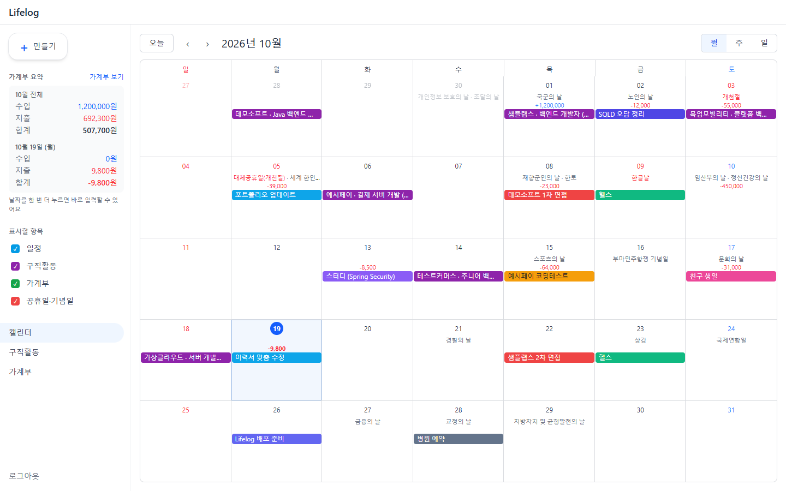
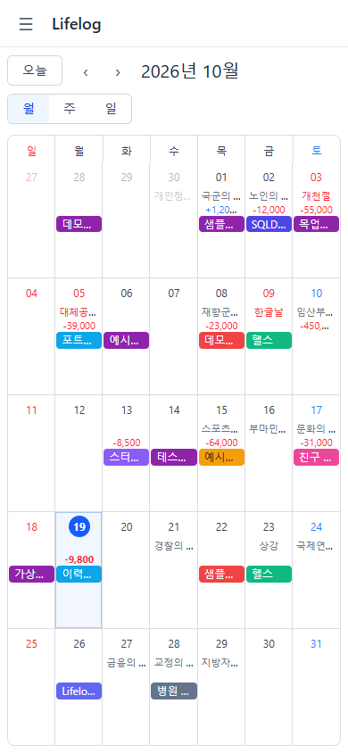
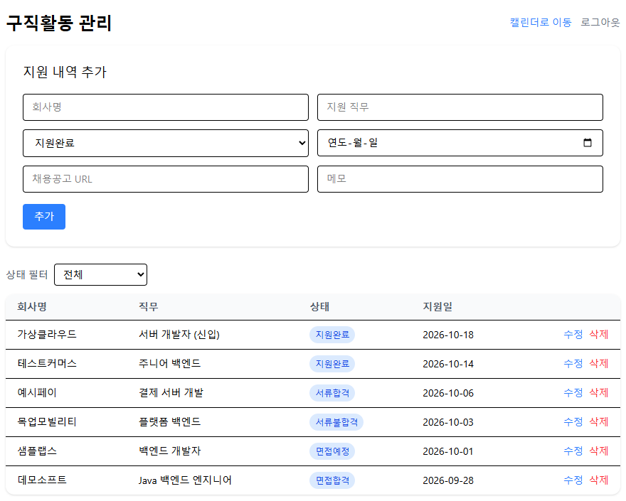
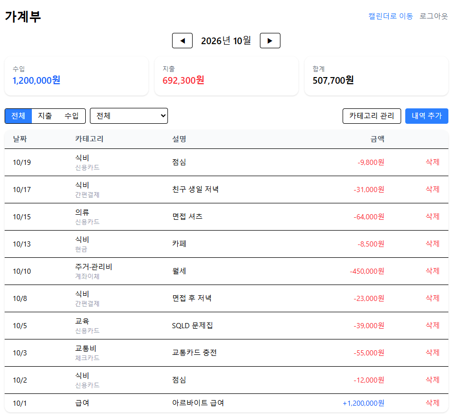
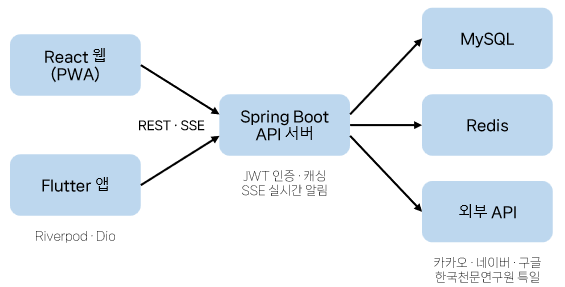

# Lifelog

캘린더 하나에서 **일정 · 구직활동 · 가계부**를 함께 관리하는 개인 서비스입니다. (웹 · 모바일)



## 프로젝트 목표

공백기 동안 직접 쓰려고 만든 서비스이자, **AI를 활용한 개발 방식을 익히기 위한 실험**입니다.
AI 에이전트(Claude Code)로 실제 서비스를 어디까지 만들 수 있는지 확인하려고 시작했습니다.

- 구현은 에이전트가 하고, **무엇을 만들지 · 설계안 채택 · 허용할 트레이드오프**는 직접 결정했습니다
- 모든 변경은 PR로 올리고, 리뷰 · 검증 에이전트의 결과와 테스트를 확인한 뒤 머지했습니다
- 결과: PR 50건 머지, 백엔드 테스트 860건 이상 (실제 MySQL · Redis 통합 테스트 포함), 백엔드 · 웹 · 앱 CI

## 주요 기능

| 기능 | 내용 |
|------|------|
| 캘린더 | 일정 등록 · 수정 · 삭제, 월 / 주 / 일 보기, 공휴일 · 기념일 · 24절기 표시 |
| 구직활동 | 지원 상태 · 지원일 · 공고 링크 관리, 상태별 필터 |
| 가계부 | 수입 / 지출, 결제수단, 카테고리, 월 요약 · 카테고리별 지출 |
| 겹쳐 보기 | 캘린더에 구직활동 · 가계부 일별 합계를 함께 표시 |
| 인증 | 일반 로그인 + 카카오 · 네이버 · 구글 소셜 로그인 |
| 실시간 | 다른 기기에서 바꾼 내용이 SSE로 웹 · 앱에 즉시 반영 |
| 모바일 | React 웹을 iPhone 홈 화면 앱(PWA)으로 사용, Flutter 앱 병행 |

| 모바일 (PWA) | 구직활동 | 가계부 |
|:---:|:---:|:---:|
|  |  |  |

## 시스템 구성



| 구분 | 기술 |
|------|------|
| Backend | Java 21, Spring Boot 4.1, Spring Data JPA, Spring Security, JJWT, Springdoc OpenAPI |
| Data | MySQL 8, Redis 7 |
| Web | React (Vite), TypeScript, Zustand, react-big-calendar |
| App | Flutter, Riverpod, Dio, go_router |
| Infra | Docker Compose, GitHub Actions |

Gradle 멀티모듈 `api → domain ← infrastructure` (도메인이 JPA · Redis 구현에 의존하지 않도록 분리)

## 핵심 설계

- **Refresh Token 회전 · 재사용 탐지** ([#22](https://github.com/haemin4738/Schedule_SideProject/pull/22), [#40](https://github.com/haemin4738/Schedule_SideProject/pull/40))
  로그인마다 세션을 만들고 세션별 현재 토큰(jti)만 Redis에 저장합니다. refresh마다 Lua 스크립트로 토큰을 원자적으로 교체하고,
  두 세대 전 토큰이 재사용되면 탈취로 보고 사용자의 모든 세션을 폐기합니다. 응답 유실에 대비해 직전 토큰은 30초 동안 허용하고, 사용자당 세션은 10개로 제한합니다.
- **소셜 로그인 계정 연결** ([#19](https://github.com/haemin4738/Schedule_SideProject/pull/19))
  서버가 제공자 code · 토큰을 직접 검증한 뒤 자체 JWT를 발급합니다. 같은 이메일의 일반 회원은 자동으로 합치지 않고 비밀번호를 확인한 뒤 연결합니다(사전 계정 탈취 방지).
- **커밋 이후 캐시 무효화 · SSE 알림** ([#27](https://github.com/haemin4738/Schedule_SideProject/pull/27))
  `@TransactionalEventListener(AFTER_COMMIT)`에서 캐시 무효화와 SSE 전송을 처리해, 커밋 전 데이터가 캐시나 화면에 반영되지 않게 했습니다.
- **공공데이터 특일 API 연동** ([#25](https://github.com/haemin4738/Schedule_SideProject/pull/25))
  한국천문연구원 API(공휴일 · 기념일 · 24절기)를 연도 단위로 DB에 저장합니다. 3개 API가 모두 정상일 때만 교체하고, 실패하면 기존 데이터를 유지한 채 10분 뒤 다시 시도합니다.

## 트러블슈팅

- **Spring Boot 4 업그레이드 중 발견한 캐시 500 오류** ([#14](https://github.com/haemin4738/Schedule_SideProject/pull/14))
  `Stream.toList()`가 만든 불변 리스트를 Redis 캐시가 역직렬화하지 못해, 캐시에 적중하면 항상 500이 나던 기존 버그를 찾았습니다. `ArrayList`로 반환하도록 바꾸고, 캐시 조회가 실패하면 DB를 조회하는 에러 핸들러를 추가했습니다.
- **네이버 앱 로그인 인가 code 탈취 위험** ([#42](https://github.com/haemin4738/Schedule_SideProject/pull/42))
  code를 앱 스킴으로 그대로 넘기던 구조를 바꿨습니다. 이제 서버가 code를 교환하고, 앱에는 verifier 해시에 묶인 1회용 ticket만 전달합니다(PKCE 방식).
- **로그아웃 후 이전 사용자 데이터가 보이던 문제** ([#29](https://github.com/haemin4738/Schedule_SideProject/pull/29))
  Flutter provider가 전역 상태로 남아 있던 것이 원인이었습니다. `autoDispose`로 바꾸고, 비동기 요청 뒤에 `mounted`를 확인하도록 수정했습니다.

## 실행 방법

```bash
cp .env.example .env            # 값 채우기 (DB 계정, JWT secret, 소셜 로그인 · 공공데이터 키는 선택)
docker compose up -d            # MySQL, Redis

cd backend
./gradlew :api:bootRun --args='--spring.profiles.active=local'   # .env 값을 환경변수로 export 한 셸에서 실행

cd ../frontend
npm install && npm run dev      # http://localhost:5173
```

- API 문서: `docs/api-spec.yaml` (OpenAPI 3.0), 로컬 Swagger UI `http://localhost:8080/swagger-ui.html`
- 소셜 로그인 콘솔 설정: [docs/social-login-console-setup.md](docs/social-login-console-setup.md)

## 진행 상황

- [x] 일정 코어 · JWT 인증 · React / Flutter 연동
- [x] Redis 캐싱 · SSE 실시간 반영
- [x] 구직활동 · 가계부 확장, 소셜 로그인, 캘린더 겹쳐 보기, PWA
- [ ] CQRS + Elasticsearch + Kafka
- [ ] 배포 (노트북 서버) + n8n 알림 자동화
